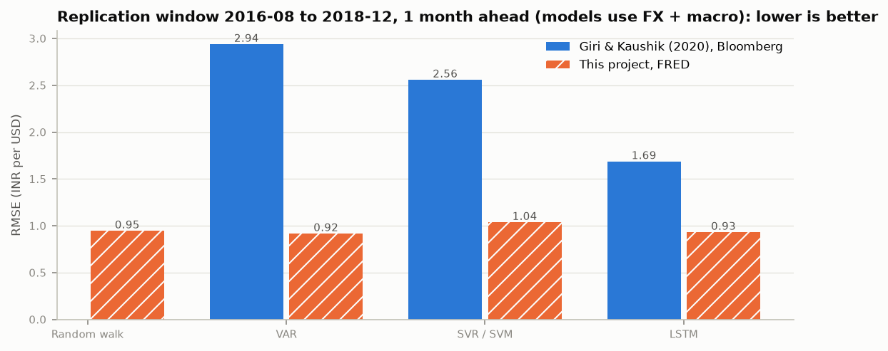
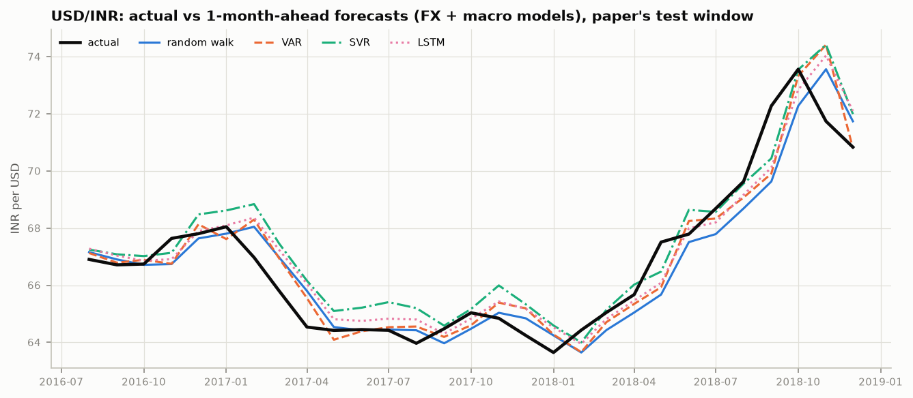
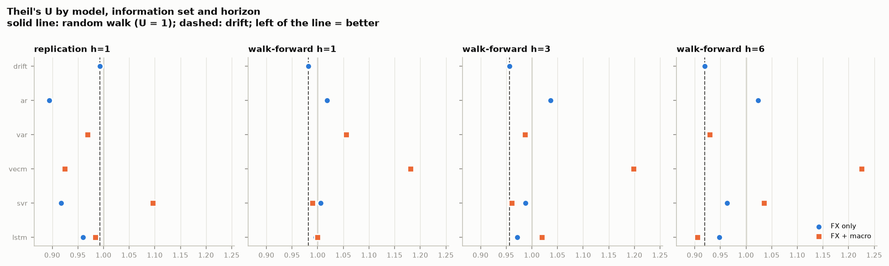
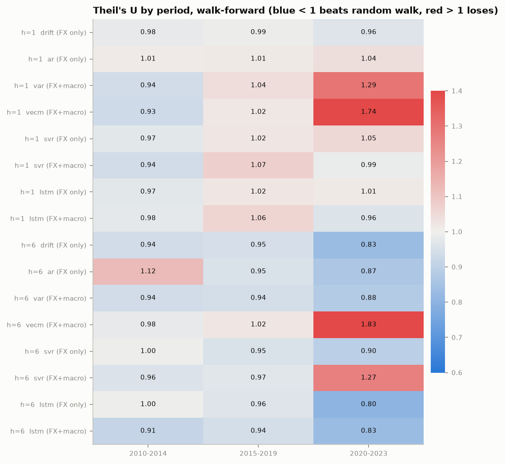

# Forecasting the USD/INR Exchange Rate with Macroeconomic Indicators: Econometric, Machine-Learning and Deep-Learning Models Against Simple Benchmarks

**Author:** Anshu Kumar Sharma · **Course:** Machine Learning coursework · **Code and data:** https://github.com/Anshu2003-commits/ML_PROJECT_ (tag `v1.2`)

---

## Abstract

This project revisits Giri & Kaushik (2020), who reported that an LSTM (97.83% "accuracy") and an SVM (97.17%) outperform a VAR (96.31%) when forecasting monthly USD/INR from US–India macroeconomic indicators. We rebuild the study on public FRED data (1994–2023) with three additions the original lacks: naive benchmarks (random walk and drift), leakage-free expanding-window evaluation over 2010–2023 at 1-, 3- and 6-month horizons, and formal tests of predictive accuracy (Diebold–Mariano, Clark–West). On the paper's own test window, a "no change" forecast has an RMSE of 0.95 INR (1.28 on end-of-month rates), below the paper's best model (LSTM, 1.69 INR), and its "accuracy" is 98.9%. Our re-implemented VAR, SVR and LSTM all reach RMSEs of 0.87–1.04 INR on that window, but none is significantly better than the random walk. Over 2010–2023, no model significantly beats the random walk or a drift forecast at any horizon (RQ1), and the ML/DL models are not significantly better than the VAR. Macroeconomic differentials do contain statistically significant predictive information beyond exchange-rate history in 6 of 9 model-family/horizon cases (Clark–West, mostly at 3–6 months), but the RMSE gains are at most about 9% and do not survive comparison with drift (RQ2). Model rankings change across sub-periods: macro models do best in 2010–2014 and worst in 2020–2023. The results are robust to publication lags, to the exchange-rate definition and to using a market rather than a policy interest rate for India.

---

## 1. Introduction

Exchange-rate forecasting is a standard test case for forecasting methods. Since Meese & Rogoff (1983), structural models based on macroeconomic fundamentals have struggled to beat a random walk out-of-sample, especially at short horizons (Cheung, Chinn & Pascual, 2005; Rossi, 2013). Recent studies apply machine learning (ML) and deep learning (DL) to the problem, often reporting high accuracy. One such study is Giri & Kaushik (2020), which forecasts monthly USD/INR from seven US–India macroeconomic variables and finds LSTM > SVM > VAR.

That study leaves three questions open. First, it reports no naive benchmark: a level "accuracy" of 97% may or may not be impressive for a series that moves about 1% per month. Second, it evaluates on a single 29-month test window with a single train/test split. Third, it does not test whether differences between models, or the contribution of macro variables, are statistically significant.

This project addresses two research questions:

- **RQ1.** How effectively can multivariate macroeconomic indicators be used to forecast USD/INR, and how do ML (SVR) and DL (LSTM) models compare with the econometric VAR in forecasting accuracy?
- **RQ2.** To what extent do macroeconomic indicators improve USD/INR forecasts compared with using exchange-rate history alone, and how does this differ between SVR, LSTM and the VAR approach?

Contributions: (i) a full replication on public data with naive benchmarks; (ii) a leakage-free evaluation design shared by all models; (iii) a matched "FX only" vs "FX + macro" comparison inside each model family, tested with Clark–West; (iv) sub-period, publication-lag and ablation analyses; (v) a tested, reproducible codebase.

## 2. Background

**Fundamentals and exchange rates.** Standard theories link the exchange rate to relative prices (purchasing power parity), interest differentials (uncovered interest parity) and relative money and output (the monetary model). Out-of-sample, these links are weak. Meese & Rogoff (1983) found that structural models do not beat a random walk at horizons up to a year. Mark (1995) found more predictability at long horizons, and Rossi (2013) concludes that predictability depends on the model, the horizon and the sample. Engel & West (2005) give one explanation: when fundamentals are close to random walks and the discount factor is close to one, exchange rates behave almost like random walks even if the models are correct.

**Models.** The VAR (Sims, 1980) models each variable as a linear function of lags of all variables; when variables are cointegrated (Johansen, 1991), a vector error-correction model (VECM) adds long-run relationships. Support vector regression (Vapnik, 1995; Drucker et al., 1997) fits a flat function within an ε-insensitive tube, using a kernel for nonlinearity. LSTMs (Hochreiter & Schmidhuber, 1997) are recurrent networks with gated memory cells for sequence data.

**Forecast evaluation.** Diebold & Mariano (1995), with the small-sample correction of Harvey, Leybourne & Newbold (1997), test whether two forecasts have equal expected loss. When one model nests the other (FX only vs FX + macro), the DM test is undersized; Clark & West (2007) provide an adjusted test for that case.

## 3. Data

**Source and sample.** Seventeen monthly FRED series (Table 1), fetched 2026-11-09 and committed to the repository with SHA-256 hashes. The target is `EXINUS` (INR per USD, monthly average). The panel runs from 1994-04, matching the paper, to 2023-01: the last month for which all series exist, limited by India's industrial production on FRED.

**Table 1. Variables (US and India).**

| Variable | India (FRED) | USA (FRED) | Feature used (US − India) |
|---|---|---|---|
| Exchange rate (target) | `EXINUS` | — | monthly log change, `dlog_fx` |
| CPI | `INDCPIALLMINMEI` | `CPIAUCSL` | 12-month inflation differential |
| Industrial production | `INDPROINDMISMEI` | `INDPRO` | 12-month growth differential |
| Short-term interest rate | `IRSTCI01INM156N` | `FEDFUNDS` | rate differential (pp) |
| Broad money M3 | `MABMM301INM189N` | `MABMM301USM189S` | 12-month growth differential |
| Reserves excl. gold | `TRESEGINM052N` | `TRESEGUSM052N` | 12-month growth differential |
| Share prices | `SPASTT01INM661N` | `SPASTT01USM661N` | monthly return differential |
| Exports, imports | `XTEXVA01INM667S`, `XTIMVA01INM667S` | `XTEXVA01USM667S`, `XTIMVA01USM667S` | trade-balance ratio differential |

**Feature design.** The paper uses raw level differences (USA − India). Raw levels are in different units (for example, US M3 in USD and India's in INR) and use different index base years, so their difference has no economic meaning. We instead use unit-free differentials, each tied to a theory (Table 1). Twelve-month changes also remove seasonality from India's non-seasonally-adjusted CPI and M3 without fitting anything, so they cannot leak test information.

**Data issues found and documented.** (i) India's "immediate" interest rate on FRED equals the RBI central-bank rate in 346 of 349 months and is flat at 6% from 2003 to 2012, so `rate_diff` measures a *policy*-rate differential. A robustness variant uses RBI's weighted average call money rate instead (Section 5.5). (ii) India's seasonally adjusted M3 ends in 2018-12, so the non-adjusted series is used. (iii) US CPI for October 2025 was never published; this is outside the sample. (iv) COVID causes extreme values in industrial-production growth in 2020–21.

**Diagnostics** (training period only, to 2016-07). Every log level is non-stationary (ADF and KPSS). Of the differentials, `dlog_fx` and equity returns are stationary; the others are differenced once for the VAR. Johansen's trace test finds one cointegrating relation among log FX, relative prices, output, money and the rate differential. Bivariate Granger tests reject non-causality (5%) only for the IP-growth and trade-balance differentials. Monthly FX changes have lag-1 autocorrelation of about 0.30, partly an artefact of monthly averaging (Working, 1960).

## 4. Methodology

### 4.1 Forecasting target and information sets
At forecast origin *t* (the last month observed), the target is the *h*-month log change *y* = log FX(*t*+*h*) − log FX(*t*), for *h* ∈ {1, 3, 6}. Level forecasts are FX(*t*)·exp(ŷ). Two information sets are compared:
- **FX only:** lags of `dlog_fx`.
- **FX + macro:** lags of `dlog_fx` plus lags of the seven differentials.

Every model receives the same rows (12 lags built) and therefore forecasts exactly the same origins; the runner checks this.

### 4.2 Evaluation design
- **Replication split:** fit with data up to 2016-07, forecast targets 2016-08 to 2018-12 (29 months, as in the paper).
- **Walk-forward (main):** an expanding window refit every January from 2010 to 2022 (13 refits), forecasting every month until the next refit. This gives 156 forecasts at *h* = 1, 154 at *h* = 3 and 151 at *h* = 6, with targets up to 2023-01.
- **Leakage control:** at a refit date *T*, models train only on origins with *t* + *h* ≤ *T* (an *h*-month embargo, since overlapping targets would otherwise leak). All scaling, differencing decisions, lag selection, cointegration ranks, hyperparameter tuning and early stopping use the training window only. Automated tests check each of these rules (Appendix B).

### 4.3 Models

| Model | Information | Specification (re-chosen at every refit from training data) |
|---|---|---|
| Random walk | — | ŷ = 0 (benchmark) |
| Drift | FX only | ŷ = mean training *y* |
| AR | FX only | direct *h*-step OLS on FX lags, *p* ∈ 0..12 by AIC |
| VAR | FX + macro | `dlog_fx` + 7 differentials; differencing by ADF; *p* by AIC (always 1); iterated forecasts |
| VECM | FX + macro | log FX, relative prices/output/money, rate differential; rank by Johansen trace; iterated |
| SVR (RBF) | both | inputs and target standardised; grid over lags {1, 3, 6}, C {0.1…10⁴}, γ {10⁻⁴…0.1}, ε {0.05, 0.1, 0.5}; 5-split time-series CV with an (*h*−1)-row gap |
| LSTM | both | 1 layer (16/32 units) + dropout 0.2; lookback 6/12 chosen by validation loss; early stopping on the last 20% of training rows; average of 5 seeds |

The AR is the FX-only counterpart of the VAR (a one-variable VAR is an AR).

### 4.4 Metrics and tests
We report RMSE, MAE, MAPE and MPE in INR, the paper's "accuracy" (100% − MAPE), directional accuracy (hit rate) and **Theil's U** (RMSE ÷ random-walk RMSE on the same origins; U < 1 beats "no change"). Diebold–Mariano tests (HLN-corrected, two-sided) compare models with each other and with the benchmarks. Clark–West tests (one-sided) compare FX-only and FX + macro versions of each family. Both use squared errors of *y* and a long-run variance with *h* − 1 lags. No multiple-testing correction is applied; individual p-values should be read with that in mind.

## 5. Results

### 5.1 Replication of the base paper



*Figure 1. RMSE on the paper's test window (2016-08 to 2018-12, h = 1).*

On the paper's test window, the random walk has RMSE 0.95 INR, MAPE 1.07% and "accuracy" 98.93%. All three of the paper's models are worse: VAR 2.94, SVM 2.56, LSTM 1.69 INR. Our implementations are much closer to the actual series: VAR 0.92, SVR 1.04 (0.87 with FX only) and LSTM 0.93 (0.91 with FX only). The paper used Bloomberg data, which is probably end-of-month; on end-of-month rates (`DEXINUS`), the random walk still has RMSE 1.28 INR and 98.69% "accuracy". The gap is too large to be explained by the data definition.

Two conclusions follow. First, "accuracy" above 96% is not informative for monthly FX: every model in this study, including the naive ones, scores between 95.3% and 99.1%. Second, the paper's ranking (LSTM > SVM > VAR) is not reproduced. On our data no pairwise difference among the multivariate models is significant on this window (all DM p > 0.07). The best model on this window is the simplest learned one, the FX-only AR (U 0.89; DM vs RW p = 0.06, vs drift p = 0.03).



*Figure 2. Actual USD/INR and 1-month-ahead forecasts on the paper's test window. All models largely follow the previous month's level.*

### 5.2 RQ1: macro-based forecasts and the comparison of model classes

**Table 2. Theil's U (RMSE ÷ random walk), walk-forward 2010–2023 unless stated. Random-walk RMSE: 0.95 / 1.03 / 2.07 / 3.06 INR.**

| Model | Info | Replication h=1 | h=1 | h=3 | h=6 |
|---|---|---|---|---|---|
| Drift | FX | 0.99 | **0.98** | **0.96** | 0.92 |
| AR | FX | **0.89** | 1.02 | 1.04 | 1.02 |
| VAR | FX+macro | 0.97 | 1.06 | 0.99 | 0.93 |
| VECM | FX+macro | 0.92 | 1.18 | 1.20 | 1.23 |
| SVR | FX | 0.92 | 1.01 | 0.99 | 0.96 |
| SVR | FX+macro | 1.10 | 0.99 | 0.96 | 1.03 |
| LSTM | FX | 0.96 | 1.00 | 0.97 | 0.95 |
| LSTM | FX+macro | 0.98 | 1.00 | 1.02 | **0.905** |



*Figure 3. Theil's U by model and horizon. Solid line: random walk; dashed line: drift. Circles: FX only; squares: FX + macro.*

- **Against benchmarks.** No model beats the random walk at the 5% level in any setting. Drift is the strongest simple forecast: it improves on the random walk at every walk-forward horizon (U 0.98 / 0.96 / 0.92; DM p = 0.09 / 0.12 / 0.10), reflecting the rupee's steady depreciation. No model significantly beats drift in the walk-forward test. The best point estimate, LSTM + macro at 6 months (U 0.905), has DM p = 0.14 against the random walk and p = 0.47 against drift. Several models are significantly *worse* than drift: SVR at 6 months (FX only p = 0.005; FX + macro p = 0.04), FX-only LSTM at 3 months (p = 0.04) and LSTM + macro at 1 month (p = 0.049).
- **Between model classes.** Among the macro-based models, the VAR is never significantly beaten by SVR or LSTM. The only significant pairwise result is LSTM + macro over SVR + macro at 6 months (p = 0.02); the VAR beats the VECM at 3 and 6 months (p = 0.06 and 0.09). The VECM is the worst model out-of-sample (U 1.18 to 1.23): its estimated cointegration rank changes between refits (0, 1 or 2), so its long-run relation is not stable enough to forecast with.
- **Direction.** Hit rates lie between 0.47 and 0.72. Drift, which always predicts depreciation, is right 58% / 62% / 68% of the time at 1 / 3 / 6 months, and no model is clearly better at calling direction.

**Answer to RQ1.** Macroeconomic indicators allow USD/INR forecasts about as accurate as simple benchmarks (RMSE within roughly ±10% of the random walk), but not significantly better than either the random walk or drift. ML and DL models do not significantly outperform the VAR; the LSTM's advantage is limited to a non-significant gain at the 6-month horizon. The paper's conclusion that ML/DL clearly beats econometrics does not hold on this data and design.

### 5.3 RQ2: value of macroeconomic information

**Table 3. Clark–West tests: FX only vs FX + macro within each family (one-sided p; H₁ = macro improves accuracy). "RMSE Δ" = change in RMSE from adding macro data.**

| Family | Replication h=1 | h=1 | h=3 | h=6 |
|---|---|---|---|---|
| Econometric (AR → VAR) | +8.3%, p = 0.66 | +3.7%, **p = 0.01** | −4.8%, **p = 0.03** | −9.3%, **p = 0.04** |
| ML (SVR) | +19.5%, p = 0.20 | −1.6%, **p = 0.01** | −2.7%, **p = 0.007** | +7.5%, p = 0.13 |
| DL (LSTM) | +2.5%, p = 0.64 | +0.4%, p = 0.13 | +4.9%, p = 0.39 | −4.5%, **p = 0.007** |

- **On the paper's test window, macro data never helps:** RMSE rises in all three families.
- **Over 2010–2023, macro data carries significant predictive information in 6 of 9 cases:** the econometric family at every horizon, SVR at 1 and 3 months, and LSTM at 6 months.
- **Statistical vs practical gains.** Clark–West tests whether the larger model's forecasts contain useful information once the noise from estimating its extra parameters is allowed for. In one significant case (VAR at 1 month) the RMSE is still higher with macro data: the information is there, but estimation noise outweighs it in a sample of about 250 months. The largest RMSE gain is 9.3% (VAR at 6 months), and no macro model significantly beats drift.
- **Horizon pattern.** Gains concentrate at 3–6 months for the VAR and LSTM, consistent with Mark (1995). The SVR shows the opposite pattern, with no gain at 6 months, so the horizon effect is not uniform across model classes.

**Answer to RQ2.** Incorporating macroeconomic indicators improves USD/INR forecasts only modestly and inconsistently. The information is statistically detectable, mostly at medium horizons, but the accuracy gains are small (at most about 9% of RMSE), depend on the model family and period, and disappear on the paper's short window. The VAR benefits most consistently from macro data; SVR and LSTM benefit at some horizons and are hurt at others.

### 5.4 Sub-periods



*Figure 4. Theil's U by target period (walk-forward, h = 1 and 6). Blue: beats the random walk; red: loses to it.*

Macro models perform best in **2010–2014**, which includes the 2013 "taper tantrum", when India's current-account deficit drove the rupee. In that period the VAR, VECM and SVR + macro reach U 0.93–0.94 at 1 month, better than every FX-only model. In **2020–2023** the econometric macro models break down (VAR 1.29, VECM 1.74 at 1 month), while LSTM and drift do best (U 0.80–0.83 at 6 months). A single 29-month test window, as used in the paper, cannot capture this dependence on the period.

### 5.5 Robustness

- **Publication lags.** Delaying macro inputs by 1 or 2 months leaves results almost unchanged (LSTM + macro at 6 months: U 0.905 → 0.911 → 0.919), so the findings do not rely on using data before it would have been released.
- **Exchange-rate definition.** The comparison with the paper holds on end-of-month rates (Section 5.1).
- **India's interest rate.** Re-running everything with RBI's weighted average call money rate (a market rate, from RBI's DBIE database) in place of FRED's policy-rate proxy changes individual Theil's U values by up to about 0.05 but not the conclusions. No model significantly beats the random walk or drift. Macro data is significant (Clark–West, 5%) in 7 of 9 walk-forward cases instead of 6. The LSTM gains most (h = 3: U 1.02 → 0.97; h = 6: 0.905 → 0.900), while the VECM gets worse. The market-rate differential also Granger-causes FX at lag 6 (p = 0.01), which the policy rate never did.
- **SVR grid.** In a first grid, inner-CV tuning chose the smallest γ in 50 of 80 fits. Widening the grid (γ down to 10⁻⁴, C up to 10⁴), a decision made from tuning choices only, changed Theil's U by at most 0.006. Both runs are kept in the repository.
- **LSTM seeds.** FX-only LSTMs are stable across seeds (RMSE standard deviation 0.005–0.017 INR). LSTMs with macro inputs are not: at 3 months, single-seed RMSE ranges from 1.95 to 2.57 INR, so averaging seeds is essential.
- **Reproducibility.** The final run reproduced every earlier stage result exactly, and a fresh clone of the repository reproduces the committed tables (Appendix A).

### 5.6 Which macro variables help? (VAR ablation)

Removing one differential at a time from the VAR (walk-forward Theil's U, all 7 = 1.055 / 0.986 / 0.929):
- Removing **IP growth improves** the VAR at every horizon (to 0.980 / 0.949 / 0.919). The variable that Granger-causes FX in-sample hurts out-of-sample, probably because of COVID-era extremes.
- Removing the **interest-rate differential** hurts most at 1 month (1.088), making it the most useful short-horizon variable. Equity returns and reserves also help slightly at 1 month.
- At 6 months, no single variable matters much.

These results are diagnostic only. Choosing variables now, after seeing test results, would amount to tuning on the test set, so the main results keep all seven.

## 6. Discussion

**Why do macro models not beat simple benchmarks?** Three reasons are consistent with the evidence. (i) *Weak and unstable links:* the macro information is real (Clark–West) but small, and its usefulness changes by period, as with the taper tantrum vs COVID. (ii) *Estimation noise:* with about 250 monthly observations, every extra parameter costs accuracy. That cost is visible in the VAR at 1 month and in the instability of the macro LSTM across seeds. (iii) *A managed float:* the RBI intervenes heavily, which smooths the rupee and strengthens drift-like behaviour. That favours the drift benchmark.

**Why don't SVR and LSTM help more?** The SVR's tuning repeatedly chose the smoothest, nearly linear kernel settings, and the LSTMs stopped training early (median best epoch 13) with forecasts close to drift. At monthly frequency there seems to be little nonlinear structure for flexible models to exploit, and their extra flexibility mainly adds variance.

**Why does this differ from the base paper?** Possible contributors include: the absence of a benchmark; a single short test window; scaling over the full sample (which leaks the test range); features built from raw level differences with mixed units; and possibly forecasting levels rather than changes. With a common design and a common benchmark, the three model classes perform very similarly.

**Practical implication.** For monthly USD/INR, drift is a hard benchmark to beat. Macro-based models are most worth using at 3–6 month horizons and in periods when fundamentals dominate, and any claimed gain should be tested against drift, not only against "no change".

## 7. Limitations

- **Data vintage:** FRED provides revised data, not what was known in real time (ALFRED vintages were not used). The publication-lag check addresses release timing but not revisions.
- **India interest rate:** the main results use FRED's series, which is effectively the RBI policy rate. A robustness run with RBI's market call money rate (Section 5.5) leaves the conclusions unchanged.
- **Sample end:** the panel ends in 2023-01 because India's series on FRED stop; the 2023–2026 period is not evaluated.
- **Small sample:** about 250 training months limit all learned models, especially the LSTM.
- **Monthly averages:** `EXINUS` averages daily rates, which smooths changes and adds autocorrelation. End-of-month rates were used only for the benchmark check.
- **Multiple testing:** many tests are reported without correction; isolated p-values near 0.05 should not be over-read. A Model Confidence Set was not computed.
- **Search spaces:** the SVR and LSTM grids are modest by design (compute budget), although the SVR result was shown to be insensitive to widening the grid.

## 8. Conclusion

A re-implementation of Giri & Kaushik (2020) on public data, with benchmarks and proper out-of-sample testing, changes its conclusions. A "no change" forecast beats all of the paper's reported models on its own test window. Over 2010–2023, no macro-based VAR, SVR or LSTM forecast is significantly more accurate than a random walk or drift (RQ1), and the ML/DL models do not significantly outperform the VAR. Macro differentials do carry statistically significant information beyond exchange-rate history, mostly at 3–6 months, but the resulting accuracy gains are small and depend on the period and the model (RQ2). The broader lesson for ML forecasting studies is that, without a naive benchmark, a leakage-free evaluation and significance tests, high "accuracy" figures cannot show that a model has learned anything useful.

## References

- Cheung, Y.-W., Chinn, M. D., & Pascual, A. G. (2005). Empirical exchange rate models of the nineties: Are any fit to survive? *Journal of International Money and Finance*, 24(7), 1150–1175.
- Clark, T. E., & West, K. D. (2007). Approximately normal tests for equal predictive accuracy in nested models. *Journal of Econometrics*, 138(1), 291–311.
- Diebold, F. X., & Mariano, R. S. (1995). Comparing predictive accuracy. *Journal of Business & Economic Statistics*, 13(3), 253–263.
- Drucker, H., Burges, C. J. C., Kaufman, L., Smola, A., & Vapnik, V. (1997). Support vector regression machines. *Advances in Neural Information Processing Systems*, 9.
- Engel, C., & West, K. D. (2005). Exchange rates and fundamentals. *Journal of Political Economy*, 113(3), 485–517.
- Giri, A. K., & Kaushik, M. (2020). Forecasting foreign exchange rate: A multivariate comparative analysis between traditional econometric, contemporary machine learning & deep learning techniques. *arXiv:2002.10247*.
- Harvey, D., Leybourne, S., & Newbold, P. (1997). Testing the equality of prediction mean squared errors. *International Journal of Forecasting*, 13(2), 281–291.
- Hochreiter, S., & Schmidhuber, J. (1997). Long short-term memory. *Neural Computation*, 9(8), 1735–1780.
- Johansen, S. (1991). Estimation and hypothesis testing of cointegration vectors in Gaussian vector autoregressive models. *Econometrica*, 59(6), 1551–1580.
- Mark, N. C. (1995). Exchange rates and fundamentals: Evidence on long-horizon predictability. *American Economic Review*, 85(1), 201–218.
- Meese, R. A., & Rogoff, K. (1983). Empirical exchange rate models of the seventies: Do they fit out of sample? *Journal of International Economics*, 14(1–2), 3–24.
- Rossi, B. (2013). Exchange rate predictability. *Journal of Economic Literature*, 51(4), 1063–1119.
- Sims, C. A. (1980). Macroeconomics and reality. *Econometrica*, 48(1), 1–48.
- Vapnik, V. N. (1995). *The Nature of Statistical Learning Theory*. Springer.
- Working, H. (1960). Note on the correlation of first differences of averages in a random chain. *Econometrica*, 28(4), 916–918.

---

## Appendix A. Reproducibility

Environment: Python 3.11, pandas 3.1, statsmodels 0.15, scikit-learn 1.9, PyTorch 2.15 (CPU). Final results: run `final-20261109T165341Z-d112bad7`, commit `f03748e`.

```bash
pip install -r requirements.txt && pip install -e .
python -m fxforecast.data                     # panel from committed FRED snapshot
python -m fxforecast.experiments.eda          # diagnostics
python -m fxforecast.experiments.run --stage final --models drift ar var vecm svr lstm     # ~20 min
python -m fxforecast.experiments.run --stage publag1 --models svr lstm --feature-sets fx_plus_macro --publication-lag 1
python -m fxforecast.experiments.run --stage publag2 --models svr lstm --feature-sets fx_plus_macro --publication-lag 2
python -m fxforecast.experiments.analysis     # significance, sub-periods, robustness, ablation
python -m fxforecast.experiments.figures      # report figures
# robustness: RBI market call money rate (same commands with --config configs/experiment_rbi.yaml,
# stages final_rbi / publag1_rbi / publag2_rbi, then: analysis --config ... --suffix _rbi --compare-to "")
python -m pytest                              # test suite
```

Each run folder records its config, git commit, library versions, data hashes, all forecasts and the settings each model chose at each refit. The full pipeline was re-run from a fresh clone of the GitHub repository and reproduced the committed result tables ([docs/VALIDATION.md](../docs/VALIDATION.md)).

## Appendix B. Engineering summary

The code is a deterministic, configuration-driven pipeline (`src/fxforecast`) with one-way dependencies: config → data → features → models → evaluation → experiments → reporting. The automated tests check, among other things:
- no look-ahead in features, splits, scaling, tuning and VAR/VECM forecasting (future-perturbation tests);
- statistical tests on synthetic data with known answers;
- recovery of known coefficients;
- seed determinism;
- an end-to-end run on the real data.

Design decisions are logged in [docs/decisions.md](../docs/decisions.md), and the findings log for each milestone is in [docs/findings.md](../docs/findings.md).
