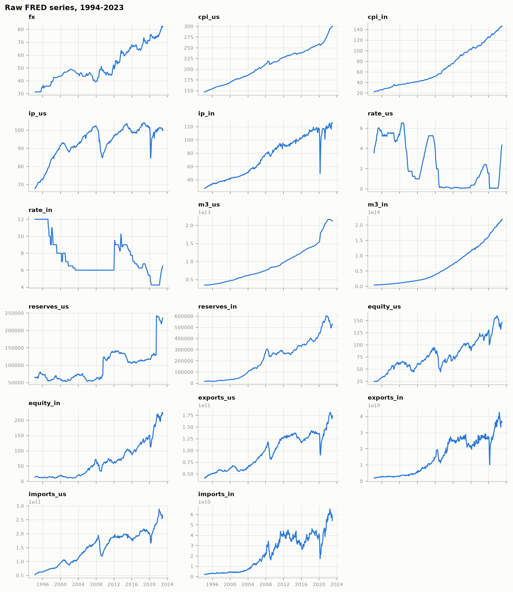
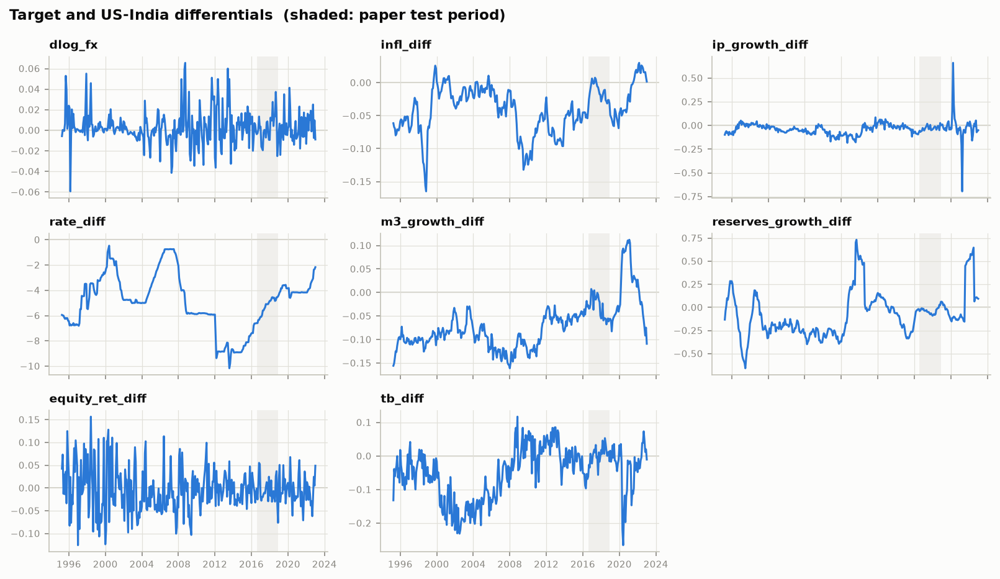
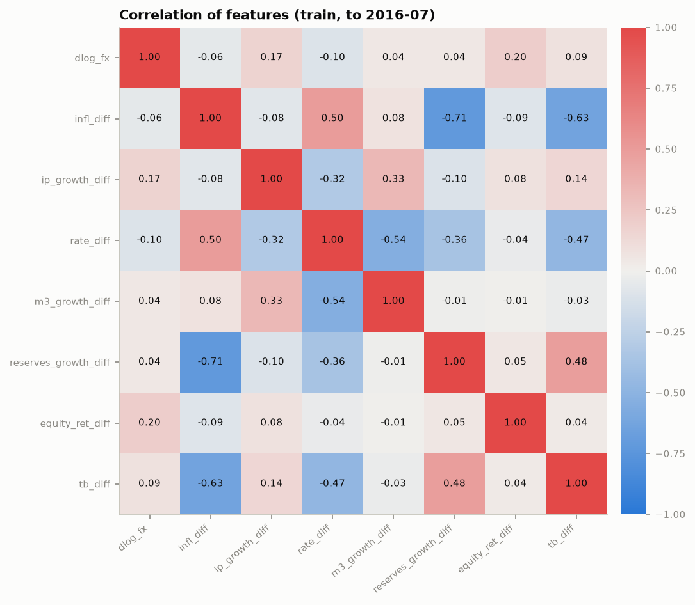
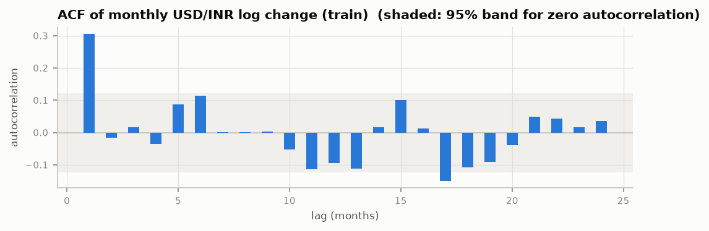

# EDA and diagnostics (M2)

Generated by `python -m fxforecast.experiments.eda`. Panel 1994-04 to 2023-01; features start 1995-04 (12-month changes need a year of history).
**All tests use the training period only (1995-04 to 2016-07, 256 months)** so the test period does not influence model choices.

## Key findings
- **Random-walk reference:** "no change" forecasts over the paper's test period (2016-08 to 2018-12) give level MAPE = **0.0107**, i.e. "accuracy" = **98.93%**. The paper reports VAR 96.31%, SVR 97.17%, LSTM 97.83% (RMSE 2.94 / 2.56 / 1.69 INR) on Bloomberg data. The result holds on end-of-month rates too (table below), so it does not depend on the FX definition.

| FX definition | n | rmse | mape | accuracy_pct |
|---|---|---|---|---|
| monthly average (EXINUS) | 29 | 0.9469 | 0.0107 | 98.9340 |
| end of month (DEXINUS) | 29 | 1.2756 | 0.0131 | 98.6866 |

- **Target autocorrelation:** Ljung-Box p-value at lag 1 = 0.000, at lag 12 = 0.000 (low p = past FX changes carry some information). Caution: `EXINUS` is a **monthly average** of daily rates, and averaging a random walk by itself creates positive lag-1 autocorrelation (about 0.25) in its changes (Working, 1960). Part of this "predictability" is therefore an artefact of averaging. That makes an AR(1) baseline essential in M4, alongside the random walk.
- **Granger causality** (5%, any of lags 1/3/6): ip_growth_diff, tb_diff.
- **Cointegration** among log FX, relative prices, output, money and the rate differential: Johansen rank = **1** at 5% (rank > 0 suggests a VECM in M5).
- **VAR lag order** on the stationary features: {'aic': 1, 'bic': 0, 'hqic': 1, 'fpe': 1}.
- **Strongest correlations with the target (train):** equity_ret_diff (+0.20), ip_growth_diff (+0.17), rate_diff (-0.10).

## Data events to keep in mind
- **India interest rate is effectively a policy rate.** `IRSTCI01INM156N` equals the RBI central-bank rate (`IRSTCB01INM156N`) in 346 of 349 months. It sits at exactly 6.0% from 2003 to early 2012, including 2008 when market call-money rates spiked. `rate_diff` therefore measures a *policy-rate* differential. See decision D11.
- **COVID base effects:** India IP collapsed in April 2020, so `ip_growth_diff` swings by about ±0.6 in 2020-21. These are extreme values for the extension test period. Any scaling or clipping must be fit on training data only.
- **US reserves jump in Aug 2021** (IMF SDR allocation), visible in `reserves_growth_diff`.

## Figures

## Stationarity of features (ADF H0: unit root; KPSS H0: stationary)
`diff_order_used` = how many times each feature is differenced before entering the VAR (from ADF on train).

| series | adf_stat | adf_p | adf_lags | kpss_stat | kpss_p | verdict | diff_order_used |
|---|---|---|---|---|---|---|---|
| dlog_fx | -5.998 | 1.7e-07 | 4 | 0.139 | 0.100 | stationary | 0 |
| infl_diff | -2.044 | 0.267 | 12 | 0.421 | 0.068 | inconclusive | 1 |
| ip_growth_diff | -1.949 | 0.309 | 13 | 0.237 | 0.100 | inconclusive | 1 |
| rate_diff | -1.364 | 0.599 | 4 | 0.881 | 0.010 | non-stationary | 1 |
| m3_growth_diff | -0.895 | 0.790 | 13 | 0.512 | 0.039 | non-stationary | 1 |
| reserves_growth_diff | -2.296 | 0.173 | 12 | 0.309 | 0.100 | inconclusive | 1 |
| equity_ret_diff | -13.082 | 1.9e-24 | 0 | 0.368 | 0.091 | stationary | 0 |
| tb_diff | -2.333 | 0.162 | 2 | 0.898 | 0.010 | non-stationary | 1 |

## Stationarity of raw (log) levels
| series | adf_stat | adf_p | adf_lags | kpss_stat | kpss_p | verdict |
|---|---|---|---|---|---|---|
| log_fx | -1.108 | 0.712 | 5 | 1.795 | 0.010 | non-stationary |
| log_cpi_us | -1.923 | 0.321 | 12 | 2.538 | 0.010 | non-stationary |
| log_cpi_in | 0.281 | 0.976 | 12 | 2.475 | 0.010 | non-stationary |
| log_ip_us | -2.544 | 0.105 | 4 | 1.722 | 0.010 | non-stationary |
| log_ip_in | -1.067 | 0.728 | 11 | 2.536 | 0.010 | non-stationary |
| rate_us | -2.135 | 0.231 | 10 | 1.750 | 0.010 | non-stationary |
| rate_in | -2.223 | 0.198 | 14 | 1.030 | 0.010 | non-stationary |
| log_m3_us | 0.614 | 0.988 | 4 | 2.527 | 0.010 | non-stationary |
| log_m3_in | -1.292 | 0.633 | 13 | 2.541 | 0.010 | non-stationary |
| log_reserves_us | -1.171 | 0.686 | 3 | 1.578 | 0.010 | non-stationary |
| log_reserves_in | -1.052 | 0.734 | 3 | 2.447 | 0.010 | non-stationary |
| log_equity_us | -2.393 | 0.144 | 6 | 1.813 | 0.010 | non-stationary |
| log_equity_in | -0.350 | 0.918 | 1 | 2.329 | 0.010 | non-stationary |
| log_exports_us | -1.190 | 0.678 | 7 | 2.420 | 0.010 | non-stationary |
| log_exports_in | -1.074 | 0.725 | 1 | 2.493 | 0.010 | non-stationary |
| log_imports_us | -1.563 | 0.502 | 8 | 2.392 | 0.010 | non-stationary |
| log_imports_in | -1.436 | 0.565 | 1 | 2.469 | 0.010 | non-stationary |

## Granger causality: p-values for "feature does not Granger-cause dlog_fx"
| causing | p_lag1 | p_lag3 | p_lag6 |
|---|---|---|---|
| infl_diff | 0.445 | 0.323 | 0.681 |
| ip_growth_diff | 0.006 | 0.012 | 0.093 |
| rate_diff | 0.902 | 0.630 | 0.657 |
| m3_growth_diff | 0.893 | 0.095 | 0.111 |
| reserves_growth_diff | 0.992 | 0.698 | 0.916 |
| equity_ret_diff | 0.966 | 0.391 | 0.747 |
| tb_diff | 0.025 | 0.044 | 0.110 |

## Johansen trace test (log levels; k_ar_diff = 1)
| H0 | trace_stat | crit_5pct | reject |
|---|---|---|---|
| rank <= 0 | 71.181 | 69.819 | True |
| rank <= 1 | 38.633 | 47.855 | False |
| rank <= 2 | 23.582 | 29.796 | False |
| rank <= 3 | 12.352 | 15.494 | False |
| rank <= 4 | 3.195 | 3.841 | False |

## Ljung-Box on dlog_fx
| lag | lb_stat | lb_pvalue |
|---|---|---|
| 1 | 24.053 | 9.4e-07 |
| 3 | 24.186 | 2.3e-05 |
| 6 | 29.938 | 4.0e-05 |
| 12 | 36.623 | 2.6e-04 |
