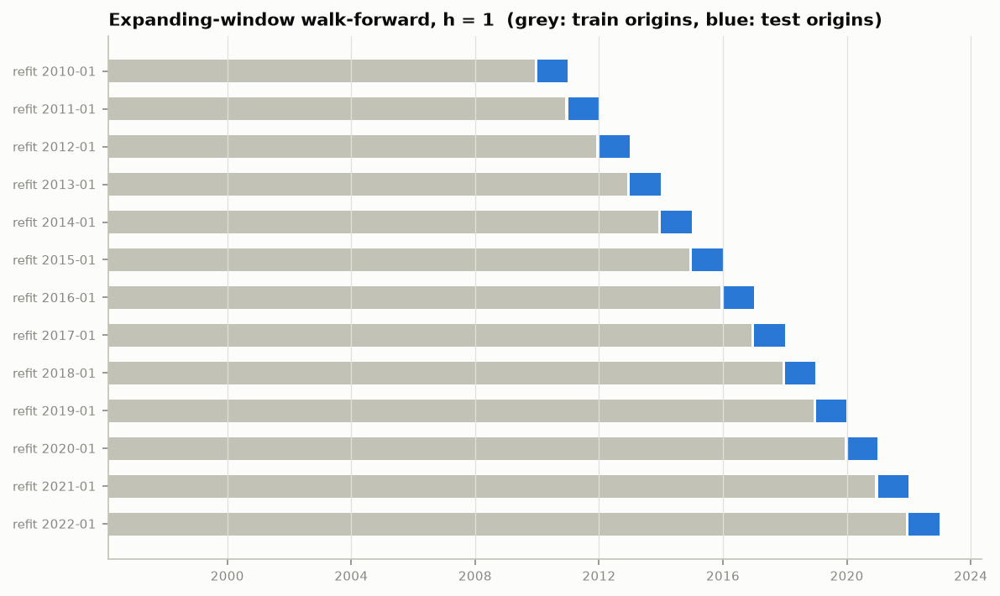

# Evaluation splits (M3)

Generated by `python -m fxforecast.experiments.splits`. Rows are **forecast origins** t: the model sees data up to t and predicts log FX(t+h) - log FX(t).
At a refit date T the model trains only on origins with t + h <= T (targets already observed), then forecasts every origin until the next refit. Feature rows use 12 lags, so the first usable origin is 1996-03.

### Replication of the paper, h = 1

| refit | train origins | n_train | test origins | test targets | n_test |
|---|---|---|---|---|---|
| 2016-07 | 1996-03 to 2016-06 | 244 | 2016-07 to 2018-11 | 2016-08 to 2018-12 | 29 |

### Walk-forward, h = 1 (156 test forecasts)

| refit | train origins | n_train | test origins | test targets | n_test |
|---|---|---|---|---|---|
| 2010-01 | 1996-03 to 2009-12 | 166 | 2010-01 to 2010-12 | 2010-02 to 2011-01 | 12 |
| 2011-01 | 1996-03 to 2010-12 | 178 | 2011-01 to 2011-12 | 2011-02 to 2012-01 | 12 |
| 2012-01 | 1996-03 to 2011-12 | 190 | 2012-01 to 2012-12 | 2012-02 to 2013-01 | 12 |
| 2013-01 | 1996-03 to 2012-12 | 202 | 2013-01 to 2013-12 | 2013-02 to 2014-01 | 12 |
| 2014-01 | 1996-03 to 2013-12 | 214 | 2014-01 to 2014-12 | 2014-02 to 2015-01 | 12 |
| 2015-01 | 1996-03 to 2014-12 | 226 | 2015-01 to 2015-12 | 2015-02 to 2016-01 | 12 |
| 2016-01 | 1996-03 to 2015-12 | 238 | 2016-01 to 2016-12 | 2016-02 to 2017-01 | 12 |
| 2017-01 | 1996-03 to 2016-12 | 250 | 2017-01 to 2017-12 | 2017-02 to 2018-01 | 12 |
| 2018-01 | 1996-03 to 2017-12 | 262 | 2018-01 to 2018-12 | 2018-02 to 2019-01 | 12 |
| 2019-01 | 1996-03 to 2018-12 | 274 | 2019-01 to 2019-12 | 2019-02 to 2020-01 | 12 |
| 2020-01 | 1996-03 to 2019-12 | 286 | 2020-01 to 2020-12 | 2020-02 to 2021-01 | 12 |
| 2021-01 | 1996-03 to 2020-12 | 298 | 2021-01 to 2021-12 | 2021-02 to 2022-01 | 12 |
| 2022-01 | 1996-03 to 2021-12 | 310 | 2022-01 to 2022-12 | 2022-02 to 2023-01 | 12 |

### Walk-forward, h = 3 (154 test forecasts)

| refit | train origins | n_train | test origins | test targets | n_test |
|---|---|---|---|---|---|
| 2010-01 | 1996-03 to 2009-10 | 164 | 2010-01 to 2010-12 | 2010-04 to 2011-03 | 12 |
| 2011-01 | 1996-03 to 2010-10 | 176 | 2011-01 to 2011-12 | 2011-04 to 2012-03 | 12 |
| 2012-01 | 1996-03 to 2011-10 | 188 | 2012-01 to 2012-12 | 2012-04 to 2013-03 | 12 |
| 2013-01 | 1996-03 to 2012-10 | 200 | 2013-01 to 2013-12 | 2013-04 to 2014-03 | 12 |
| 2014-01 | 1996-03 to 2013-10 | 212 | 2014-01 to 2014-12 | 2014-04 to 2015-03 | 12 |
| 2015-01 | 1996-03 to 2014-10 | 224 | 2015-01 to 2015-12 | 2015-04 to 2016-03 | 12 |
| 2016-01 | 1996-03 to 2015-10 | 236 | 2016-01 to 2016-12 | 2016-04 to 2017-03 | 12 |
| 2017-01 | 1996-03 to 2016-10 | 248 | 2017-01 to 2017-12 | 2017-04 to 2018-03 | 12 |
| 2018-01 | 1996-03 to 2017-10 | 260 | 2018-01 to 2018-12 | 2018-04 to 2019-03 | 12 |
| 2019-01 | 1996-03 to 2018-10 | 272 | 2019-01 to 2019-12 | 2019-04 to 2020-03 | 12 |
| 2020-01 | 1996-03 to 2019-10 | 284 | 2020-01 to 2020-12 | 2020-04 to 2021-03 | 12 |
| 2021-01 | 1996-03 to 2020-10 | 296 | 2021-01 to 2021-12 | 2021-04 to 2022-03 | 12 |
| 2022-01 | 1996-03 to 2021-10 | 308 | 2022-01 to 2022-10 | 2022-04 to 2023-01 | 10 |

### Walk-forward, h = 6 (151 test forecasts)

| refit | train origins | n_train | test origins | test targets | n_test |
|---|---|---|---|---|---|
| 2010-01 | 1996-03 to 2009-07 | 161 | 2010-01 to 2010-12 | 2010-07 to 2011-06 | 12 |
| 2011-01 | 1996-03 to 2010-07 | 173 | 2011-01 to 2011-12 | 2011-07 to 2012-06 | 12 |
| 2012-01 | 1996-03 to 2011-07 | 185 | 2012-01 to 2012-12 | 2012-07 to 2013-06 | 12 |
| 2013-01 | 1996-03 to 2012-07 | 197 | 2013-01 to 2013-12 | 2013-07 to 2014-06 | 12 |
| 2014-01 | 1996-03 to 2013-07 | 209 | 2014-01 to 2014-12 | 2014-07 to 2015-06 | 12 |
| 2015-01 | 1996-03 to 2014-07 | 221 | 2015-01 to 2015-12 | 2015-07 to 2016-06 | 12 |
| 2016-01 | 1996-03 to 2015-07 | 233 | 2016-01 to 2016-12 | 2016-07 to 2017-06 | 12 |
| 2017-01 | 1996-03 to 2016-07 | 245 | 2017-01 to 2017-12 | 2017-07 to 2018-06 | 12 |
| 2018-01 | 1996-03 to 2017-07 | 257 | 2018-01 to 2018-12 | 2018-07 to 2019-06 | 12 |
| 2019-01 | 1996-03 to 2018-07 | 269 | 2019-01 to 2019-12 | 2019-07 to 2020-06 | 12 |
| 2020-01 | 1996-03 to 2019-07 | 281 | 2020-01 to 2020-12 | 2020-07 to 2021-06 | 12 |
| 2021-01 | 1996-03 to 2020-07 | 293 | 2021-01 to 2021-12 | 2021-07 to 2022-06 | 12 |
| 2022-01 | 1996-03 to 2021-07 | 305 | 2022-01 to 2022-07 | 2022-07 to 2023-01 | 7 |
